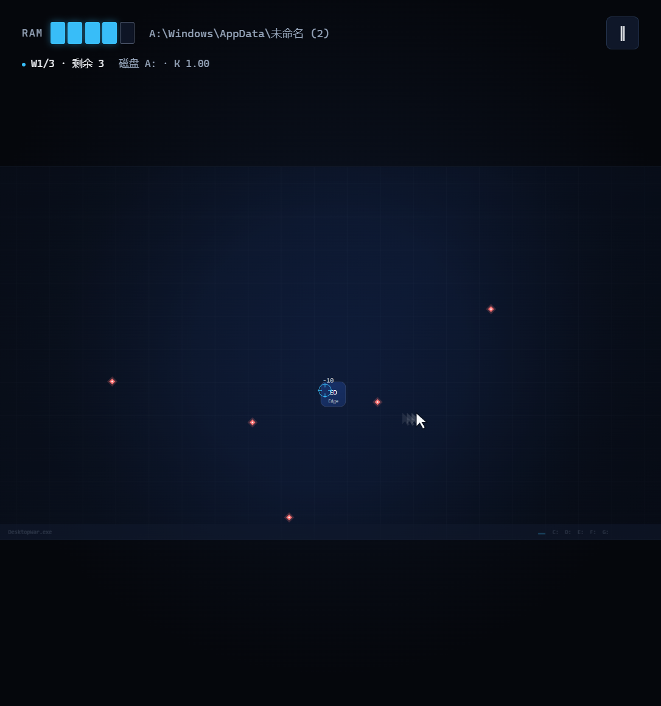
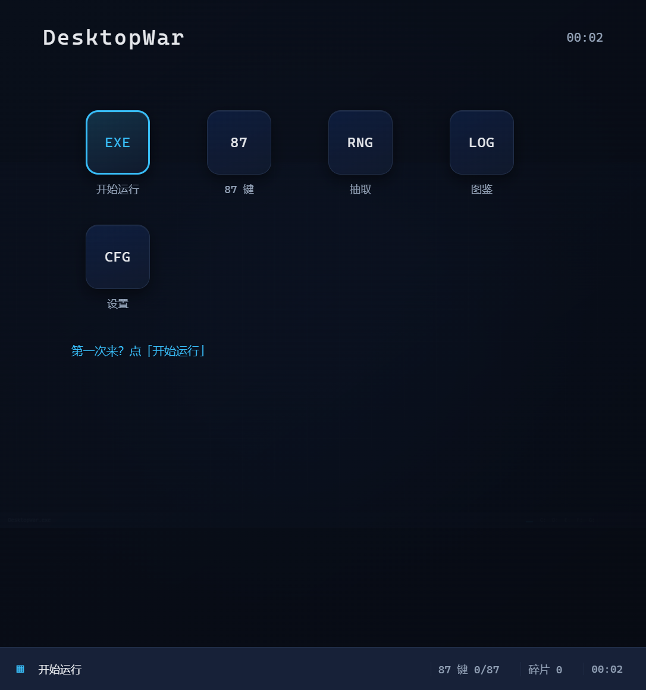
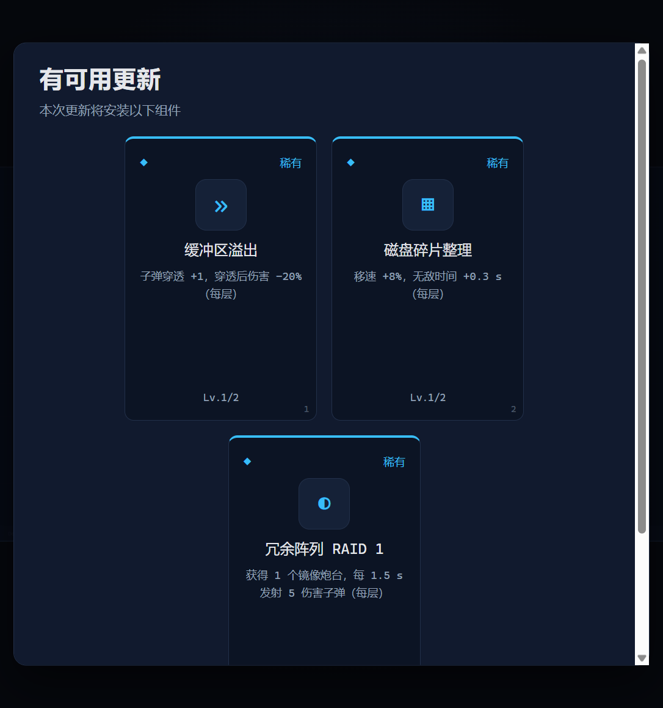
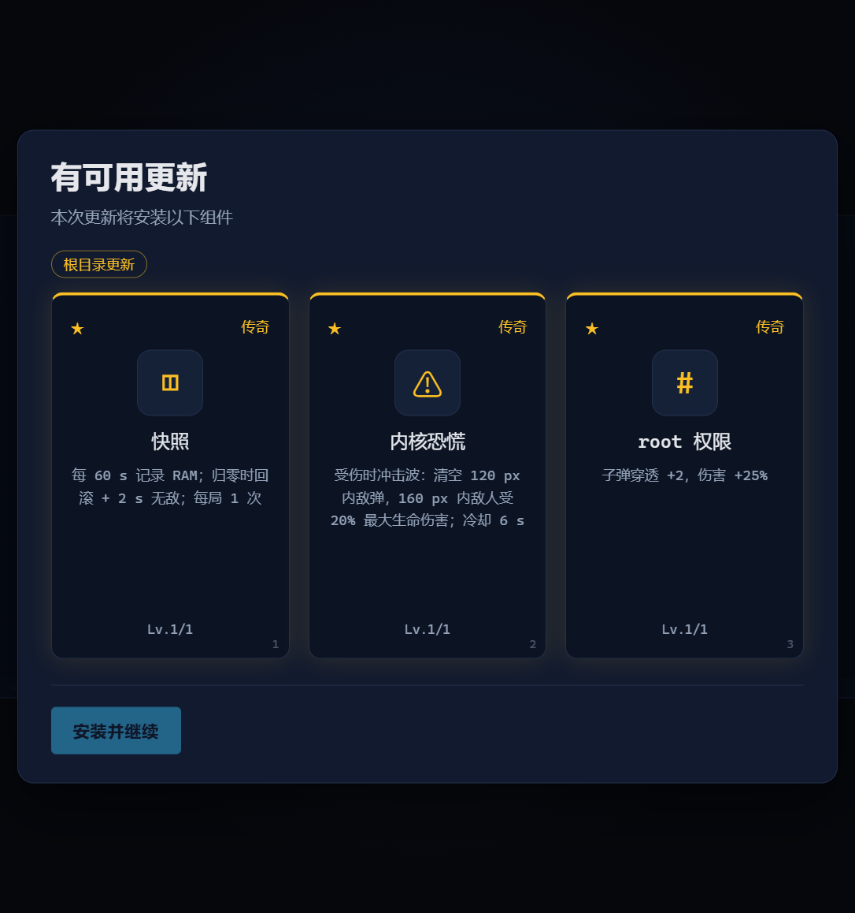
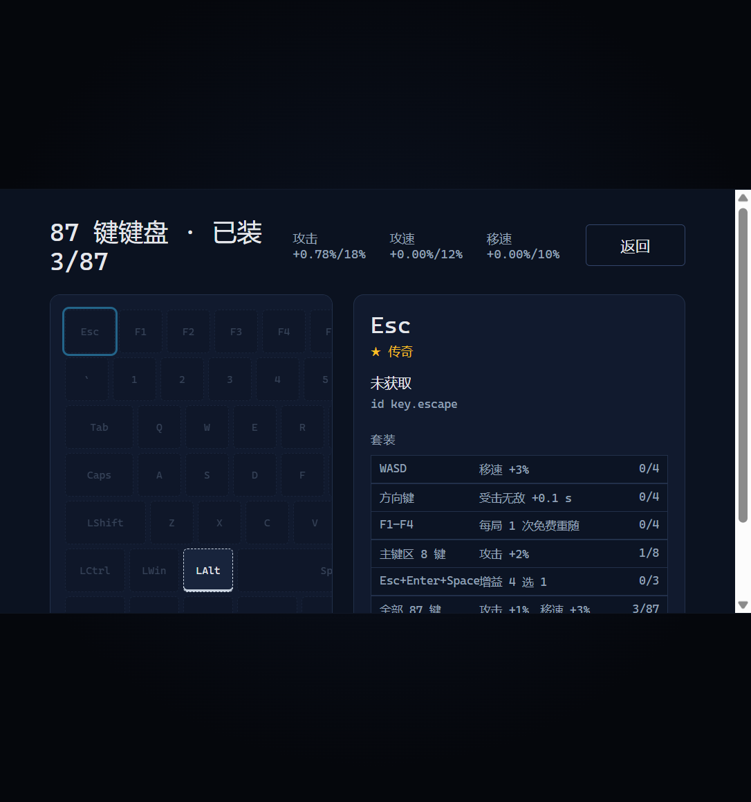
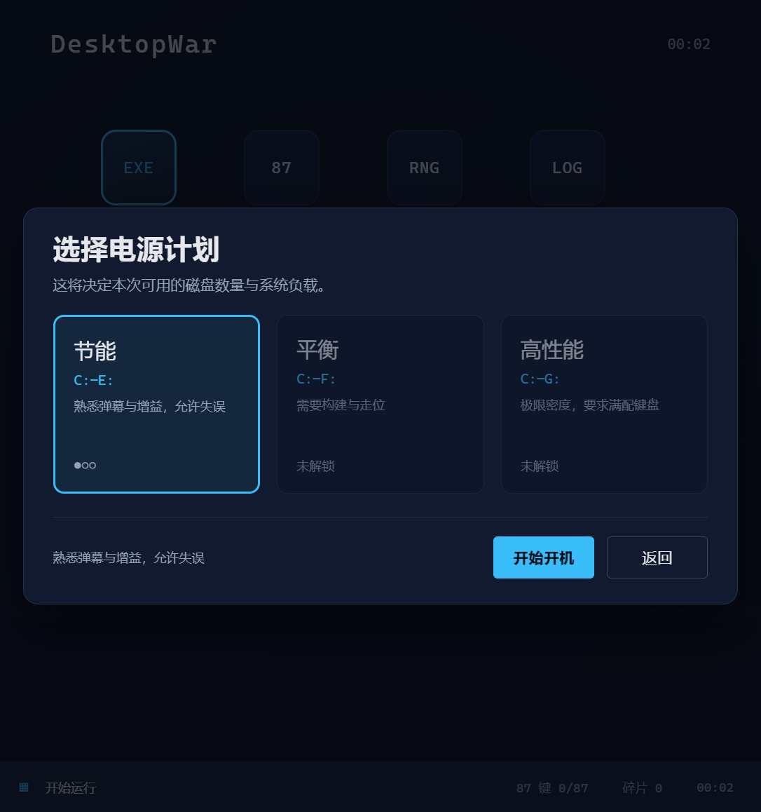
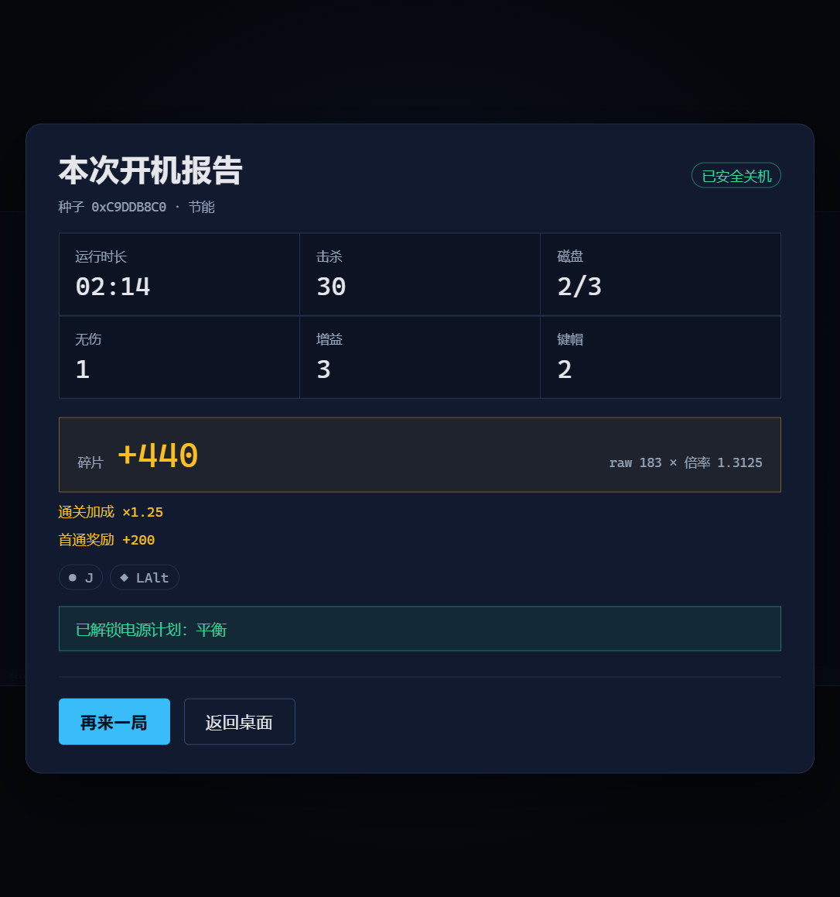

# DesktopWar / 桌面战争

> 轻量化极简 Roguelike 弹幕射击 · Canvas 2D + TypeScript + 自研轻量 ECS + Web Audio 纯合成

**你是一枚在电脑桌面里失控的光标，用一行行字符击碎满屏的软件图标，在系统崩溃前把 C: 到 G: 的磁盘全部关机。**

单局 12–35 分钟，桌面浏览器与移动浏览器（仅横屏）打开即玩，首次加载后可离线缓存，运行时零第三方依赖、零网络请求、无账号无内购。

> 当前版本 **v0.2.1**：M0–M4 已完成，M5/M6 部分完成；本版重构波次衔接（1.5s 无冻结、无字幕、前置出生预警），修复固定准星瞄准并加入输入去抖。实现状态、已知缺口与后续工作见 [`docs/README.md`](docs/README.md) §1 与 [`docs/60-里程碑与验收.md`](docs/60-里程碑与验收.md) §1。

## 玩法一览

| 概念 | 对应物 |
| --- | --- |
| 玩家本体 | 光标（WASD / 左摇杆移动），准星（鼠标 / 右摇杆瞄准），自动开火 |
| 子弹 | 等宽字符串（`0101`、`0xFF`、`sudo`、`rm`、`<div>`…） |
| 敌人 | 软件图标磁贴，6 种行为原型（弹窗 / 通知 / 广告 / 木马 / 缓存 / 更新器） |
| 生命 | RAM 5 格，归零即**蓝屏**（`DESKTOP_WAR_RAM_EXHAUSTED`） |
| 关卡 | 每层磁盘 = 5 个文件夹关 + 1 个根目录 Boss；难度决定磁盘数 C:–E:/F:/G: |
| 局内成长 | 每关增益三选一（普通/稀有/传奇 = 6:3:1），Boss 必掉传奇 |
| 局外成长 | 碎片抽键帽 → 装入 87 键键盘 → 属性与套装永久提升 |
| 通关 | 「计算机已安全关机」 |

3 档难度（节能 / 平衡 / 高性能）· 8 种关卡风格 · 8 个 Boss · 30 个增益 · 87 枚键帽 · 可复现种子 RNG。

## 快速开始

```bash
npm install
npm run dev        # http://127.0.0.1:5173
npm test           # Vitest 单元测试（22 项：公式 / RNG / 波次出生 / 键帽表 / 输入去抖 / 波次节奏 / 瞄准）
npm run typecheck  # tsc --noEmit
npm run build      # 产出 dist/，可直接静态托管
```

无后端、无环境变量，`dist/` 丢到任意静态站点即可运行（含 PWA Service Worker 离线缓存，首次加载后生效）。当前 `dist/` 158 KB，JS gzip ≈ 43 KB。

## 项目结构

```
DesktopWar/
├─ docs/       # 设计稿（00 设计总纲为唯一事实来源 SSOT，10–60 为子文档）
├─ src/        # core/ ecs/ game/ render/ input/ audio/ ui/ data/ meta/ i18n/
├─ tests/      # Vitest 单元测试
├─ tools/      # 设计期校验与平衡脚本（Python）
├─ public/     # manifest、Service Worker、许可声明
└─ screenshots/
```

逻辑分辨率固定 1280×720 横屏，固定逻辑步长 1/60 s，存档写在 `localStorage`（`desktopwar.save.v1`，带版本迁移）。

## 设计文档

想改动玩法或数值，请先读 [`docs/README.md`](docs/README.md) 与 [`docs/00-设计总纲.md`](docs/00-设计总纲.md)——数值、公式、术语与验收标准全部以 `00` 为准，改动需走 ADR 流程。

| 文档 | 内容 |
| --- | --- |
| [`docs/README.md`](docs/README.md) | 当前实现状态、文档索引、Canon 速查、文档治理 |
| [`10-玩法架构.md`](docs/10-玩法架构.md) | 状态机、操控、字符弹、敌人、波次、Boss、伤害 |
| [`20-增益与局外成长.md`](docs/20-增益与局外成长.md) | 增益全表、键帽与套装、碎片经济、存档 |
| [`30-技术架构.md`](docs/30-技术架构.md) | ECS、渲染、输入、音频、资产管线、构建、性能 |
| [`40-美术与UX规范.md`](docs/40-美术与UX规范.md) | Design Token、视觉语言、界面流程、动效、无障碍 |
| [`50-数值与平衡.md`](docs/50-数值与平衡.md) | TTK/时长模型、缩放验算、调参手册 |
| [`60-里程碑与验收.md`](docs/60-里程碑与验收.md) | 路线图、测试矩阵、发布清单、DoD |

校验工具：`python tools/check_docs.py`（设计稿一致性）、`tools/balance_model.py`（平衡预演）、`tools/keycap_table.py`（87 键属性表）。

## 截图

| 桌面 Hub | 增益三选一 | 传奇 Boss |
| --- | --- | --- |
|  |  |  |

| 键帽键盘 | 难度选择 | 开机报告 |
| --- | --- | --- |
|  |  |  |

## 许可与声明

- 代码与设计文档以 **MIT License** 开源（见 [`LICENSE`](LICENSE)）；本项目为开源、非商业发行。
- 当前构建的敌人磁贴为程序生成的首字母图标，未打包任何第三方图标集（见 [`public/licenses/iconify.md`](public/licenses/iconify.md)）。生产管线计划仅使用 CC0-1.0 / MIT / Apache-2.0 图标集（`logos`、`simple-icons`、`devicon`、`mdi`、`carbon`）。
- 文中出现的软件名称与 logo 归各自权利人所有，仅作桌面软件的描述性/戏仿识别，不暗示任何赞助或背书。
